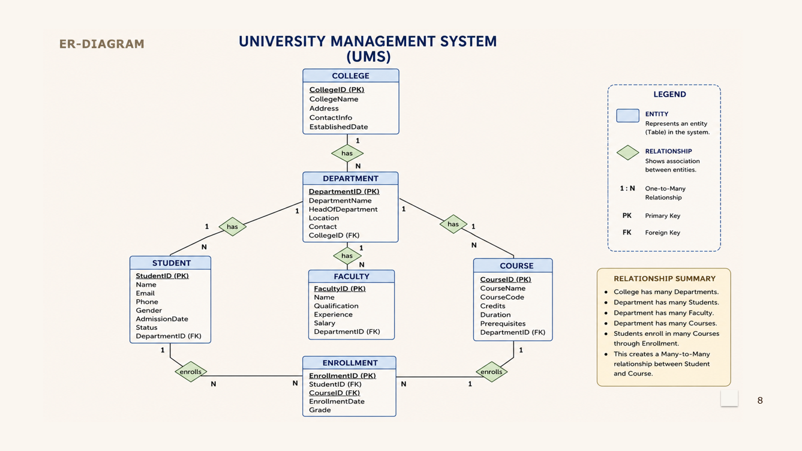

# 🎓 University Management System — DBMS Capstone Project

## 📌 Project Overview

The **University Management System (UMS)** is a relational database project developed for the **Database Management Systems (2501IT05)** course.

The project organizes university information using a structured relational database with entities, attributes, primary keys, foreign keys, and relationships.

## 🎯 Review-I Objectives

- Finalize the project title, objectives, and problem statement.
- Identify six entities and their attributes.
- Design the ER diagram and define relationships.
- Prepare the relational database schema.
- Define Primary Keys (PK) and Foreign Keys (FK).
- Create and maintain the GitHub repository.

## 🗂️ Main Entities

The project contains six main entities:

1. **College**
2. **Department**
3. **Student**
4. **Faculty**
5. **Course**
6. **Enrollment**

## 🔗 Key Relationships

- One **College** has many **Departments**.
- One **Department** has many **Students**.
- One **Department** has many **Faculty** members.
- One **Department** has many **Courses**.
- **Students** and **Courses** have a many-to-many relationship through **Enrollment**.

## 🖼️ ER Diagram

The ER diagram shows the six entities, their attributes, primary/foreign keys, and relationships.



## 🗃️ Relational Database

The database is designed using related tables with primary and foreign key constraints. The main tables are:

- `college`
- `department`
- `student`
- `faculty`
- `course`
- `enrollment`

## 💻 MySQL Implementation

The database is implemented using **MySQL** and the SQL script is provided in the `database` folder.

👉 [Open the SQL Script](database/University_Management_System_6_Entities.sql)

## 📊 Project Presentation

The Review-I presentation contains the project overview, objectives, entity descriptions, attributes, relationships, ER diagram, relational schema, key features, future enhancements, and team responsibilities.

👉 [Open the Review-I Presentation](presentation/DBMS_Review1_UMS.pptx)

## 👥 Team Members & Responsibilities

| Roll No. | Team Member | Responsibility |
|---|---|---|
| 25B11DS045 | **B. Rohith** | Database Design & College/Department Tables |
| 25B11DS286 | **K. Anandh Sai** | ER Diagram, Documentation & Presentation |
| 25B11DS331 | **M. Gowri Shankar** | Faculty & Course Management |
| 25B11DS034 | **Ayush Kumar Singh** | Attendance & Grade Management |
| 25B11DS211 | **K. Siva Lakshmi Rahul** | Student & Enrollment Management |

## 🛠️ Technologies Used

- **MySQL** — Database implementation
- **SQL** — Database definition and manipulation
- **ER Modeling** — Database design
- **GitHub** — Version control and project documentation

## 📁 Repository Structure

```text
university-management-system-dbms/
│
├── README.md
│
├── database/
│   └── University_Management_System_6_Entities.sql
│
├── diagrams/
│   └── ER_Diagram.png
│
└── presentation/
    └── DBMS_Review1_UMS.pptx
```

## 🚀 Future Scope

The system can be extended with a web interface, secure login and role-based access, student performance and attendance tracking, academic reports, data analytics, improved security, and scalability.

---

### 🎓 DBMS Capstone Project
**University Management System (UMS)**  
*Design • Structure • Implement • Manage*